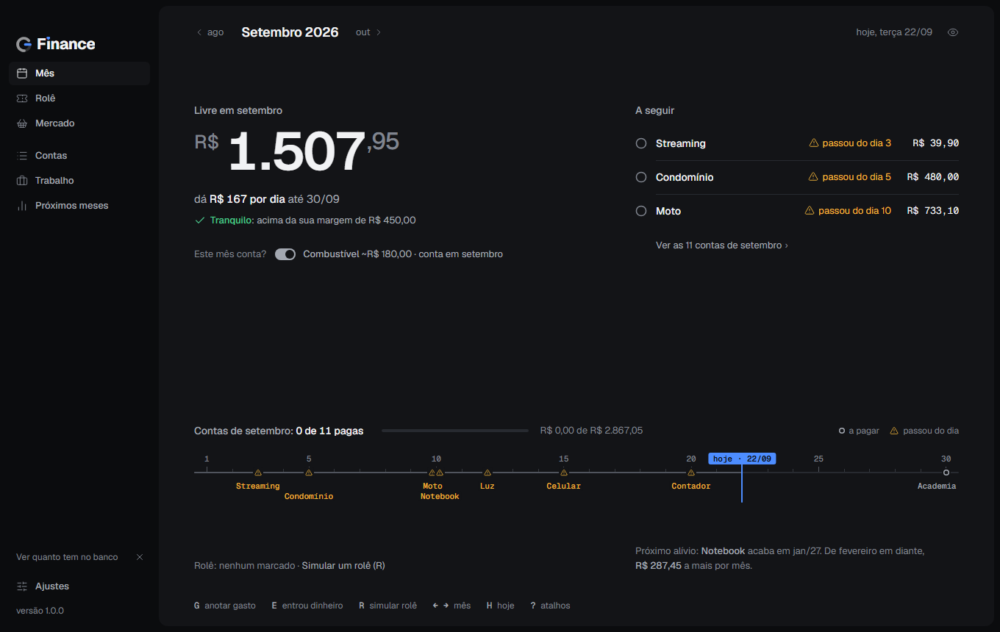
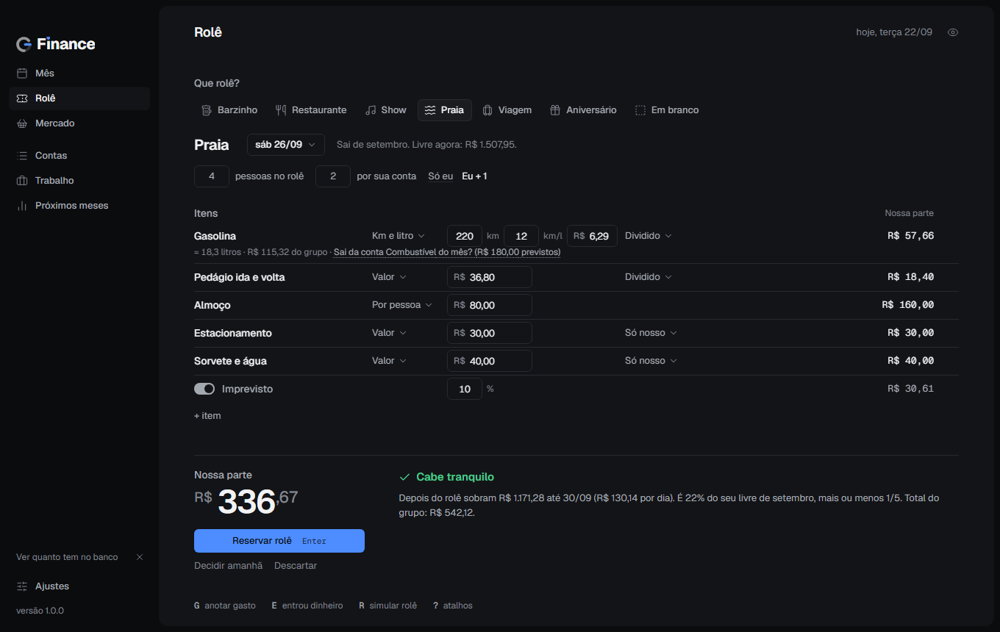
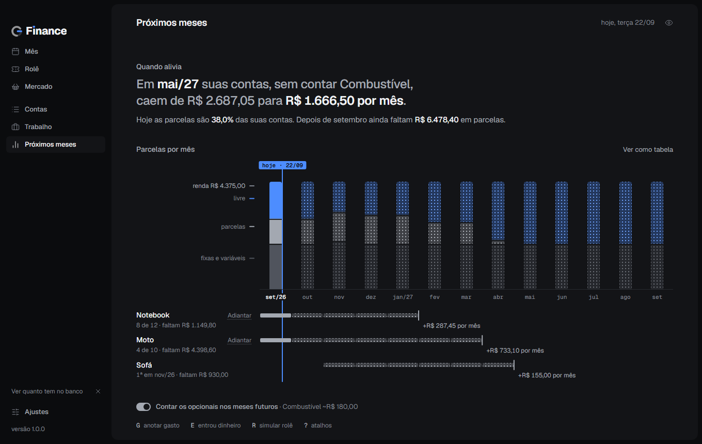
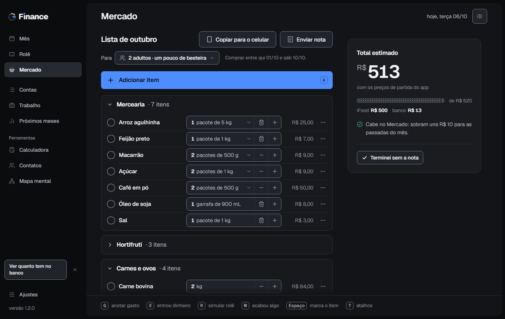
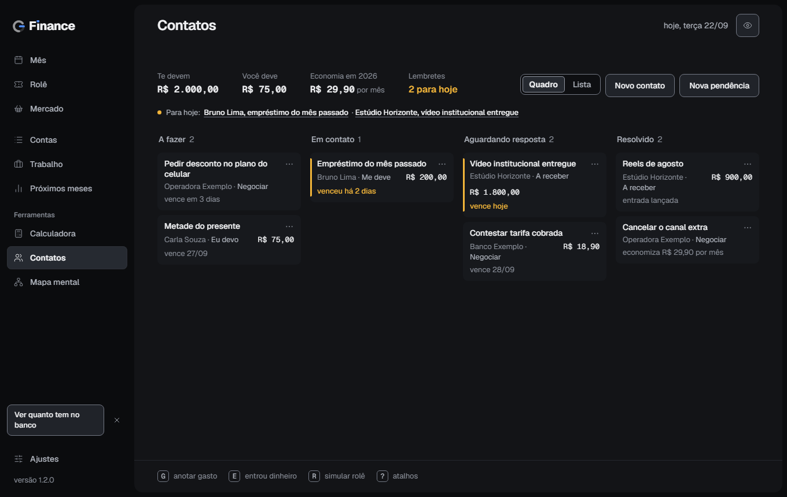

<p align="center"></p>

<h1 align="center">G Finance</h1>

<p align="center"><b>Saiba quanto está livre para gastar até o fim do mês.</b><br>
Programa de Windows para organizar as suas contas. Local, sem conta, sem nuvem, sem anúncio.</p>

<p align="center"><a href="https://github.com/giandomotion/g-finance/releases/latest/download/G-Finance-setup.exe"><b>Baixar o G Finance para Windows</b></a></p>



## O que ele faz

- **Um número que manda:** quanto está livre no mês, já descontadas as contas. Sempre calculado, nunca digitado.
- **Contas do jeito que elas são:** fixa, parcelada (mostra quando acaba), variável e "às vezes" (como a gasolina que só entra em alguns meses).
- **Simular um rolê:** monte o fim de semana e veja na hora se cabe no mês.
- **Próximos meses:** quando cada parcela acaba e quanto o mês alivia.
- **Mercado:** a lista do mês inteiro, feita para o tamanho da sua casa, e a nota fiscal do cupom conferindo a compra.
- **Cartão de crédito:** a fatura se monta sozinha e só sai do banco no dia em que você paga.
- **Calculadora:** faça a conta e ela vira gasto num clique; divide a conta, compara parcelar com à vista.
- **Contatos:** quem te deve, o que você deve e o que dá para negociar, com lembretes.
- **Mapa mental:** planeje metas e projetos com valores que se somam.
- **Trabalho e benefícios:** salário que cai sozinho e o saldo do vale no cartão.
- **Importa a sua lista:** cole o bloco de notas onde você já anota as contas e ele monta o mês.

| Rolê | Próximos meses |
|---|---|
|  |  |
| **Mercado** | **Contatos** |
|  |  |

## Baixar e instalar

1. [Baixe o instalador](https://github.com/giandomotion/g-finance/releases/latest/download/G-Finance-setup.exe) (sempre a versão mais nova). As versões anteriores ficam na [página de downloads](https://github.com/giandomotion/g-finance/releases).
2. Abra o arquivo e siga o instalador. Não pede senha de administrador.
3. Precisa de Windows 10 ou 11, 64 bits.

### "O Windows protegeu o computador"

Esse aviso aparece com programas novos que ainda não são conhecidos pelo Windows. Para seguir:

1. Clique em **Mais informações**.
2. Clique em **Executar assim mesmo**.

Quer conferir se o arquivo é o original? Cada versão traz o `SHA256SUMS.txt`. No PowerShell, na pasta do download:

```powershell
Get-FileHash .\G-Finance-setup.exe -Algorithm SHA256
```

O número tem que ser igual ao do `SHA256SUMS.txt` da mesma versão.

## Teste grátis e licença

- **7 dias grátis**, com tudo liberado, a partir do primeiro uso.
- Depois do teste, o programa fica **só para consulta** até ser ativado. **Seus dados nunca ficam presos:** backup e exportar continuam funcionando.
- **Assinatura mensal ou anual.** É o único jeito de comprar: você escolhe o mensal ou o anual.
- **Para ativar:** no programa, abra **Ativar**, copie o **código do computador** e me mande pelo WhatsApp junto com o seu nome. Eu te envio a chave; é só colar.
- **Renovar é sem chave nova:** 7 dias antes de vencer, o programa avisa com a data e o WhatsApp. Pagou, eu renovo daqui e a mesma chave passa a valer até a nova data na próxima vez que o programa confirmar pela internet. Venceu? O programa fica só para consulta, com os dados salvos, até renovar.
- A chave é pessoal e vale para um computador. Trocou de computador ou formatou? Me chama que eu mando uma chave nova.

**WhatsApp: (21) 98150-5668**

## Privacidade

- Seus gastos, contas, dívidas e valores ficam **no seu computador**. Eu não recebo esses dados. Os arquivos não são cifrados: o PIN protege o app, não o arquivo.
- **Licença ativada:** uma vez por mês o programa confirma a licença pela internet. Vão a chave de licença (com o nome que está nela), um código que identifica o computador e a versão. Sem internet, funciona por até 30 dias; depois fica só para leitura (backup e exportar continuam) até conectar.
- **Teste grátis:** com internet, uma vez por dia o programa avisa que está em uso, para evitar abuso do teste: vão um número aleatório da instalação, o código do computador, a versão, os dias que faltam e o código de quem indicou, se houver.
- **Opcionais, desligados até você ligar:** Suporte e avisos (vai o que você escrever; fica 12 meses após a última mensagem), G Finance Sync (cifrado de ponta a ponta; o servidor não consegue ler), clima (localização aproximada para Open-Meteo e OpenStreetMap), preços do Atacadão, conta (e-mail sem verificação).
- O programa pergunta ao GitHub se há versão nova. Dá para desligar em **Ajustes**.
- O servidor fica na Cloudflare (EUA) e não grava o seu IP. Não há anúncios nem telemetria.
- Para maiores de 18 anos. Política completa: dentro do programa, em **Ajustes > Internet e privacidade > Ler a política de privacidade**. Pedidos sobre seus dados: privacidade.gfinance@gmail.com, pelo chat de suporte do programa ou pelo WhatsApp (21) 98150-5668. Em **Ajustes > Internet e privacidade** também dá para baixar ou apagar o que o servidor guarda sobre você.

## Seus dados e backups

- O programa faz **backup sozinho** uma vez por dia em `Documentos\G Finance\Backups`, e antes de cada atualização.
- **Levar para outro computador:** em Ajustes, faça um backup, copie o arquivo e use **Restaurar um backup** no computador novo.
- Desinstalar não apaga os backups.

## Atualizações

- O programa procura versão nova uma vez por dia e mostra um aviso discreto.
- Só instala quando você clica em **Atualizar agora**, e faz um backup antes.
- Toda atualização é **assinada digitalmente**: o programa recusa qualquer arquivo que não tenha sido assinado por mim.

## Perguntas frequentes

**Tem versão para celular?** Está em construção. O programa do Windows já tem o **G Finance Sync** pronto para ela.

**Sincroniza?** Com o celular, sim, pelo **G Finance Sync** (opcional): cifrado de ponta a ponta, sem conta e sem nuvem que leia os seus dados. Entre dois computadores, não: a licença vale para um computador.

**E se eu formatar o computador?** Guarde um backup antes (Ajustes > Fazer backup agora). Depois de reinstalar, restaure o backup e me peça uma chave nova para o computador formatado.

**O programa conecta no meu banco?** Não. Você anota as contas e marca o que pagou; ele faz as contas.

---

Isto organiza as suas contas; não é consultoria financeira.

© 2026 Gian. Todos os direitos reservados.
